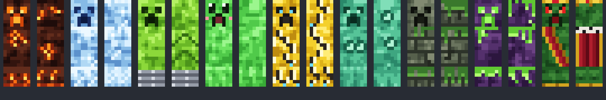

<p align="center">
  
</p>

<h1 align="center">DolfinServer</h1>
<p align="center"><strong>Un mundo de bloques. Creepers con personalidad. Tu próxima aventura.</strong></p>
<p align="center">
  Servidor de Minecraft con mods propios, un pack compartido y herramientas para mantener el mundo en marcha.
</p>
<p align="center">
  
  
  
  <a href="https://github.com/DanielCoronado1/MCServer/actions/workflows/release.yml"></a>
</p>
<p align="center">
  <a href="https://github.com/DanielCoronado1/MCServer/releases">Descargas</a> ·
  <a href="#entrar-a-jugar">Entrar a jugar</a> ·
  <a href="#montar-el-servidor">Montar el servidor</a> ·
  <a href="docs/development.md">Desarrollar</a>
</p>

---

## Lo que te espera

| | Dentro de Dolfin |
| :--- | :--- |
| **💥 Creepers propios** | Nueve variantes: fuego, hielo, eléctrico, saltarín, mini, multiplicador, tóxico, gigante y el jefe Rey Creeper. Con texturas propias. |
| **🧟 Zombis en desarrollo** | Una base de 16 variantes configurables, comandos de administración y configuración JSON recargable. Las nuevas mecánicas siguen en desarrollo. |
| **📦 Un mismo pack** | Packwiz fija versiones y hashes; AutoModpack distribuye los mods de cliente al conectarte. |
| **🧭 Un mundo compartido** | Open Parties and Claims, Ledger y LuckPerms forman parte del pack para gestionar terrenos, registros y permisos. |
| **⚙️ Detrás de la aventura** | Mods de rendimiento, administración con Crafty y herramientas para instalar, actualizar y empaquetar el servidor. |

<details>
<summary><strong>Conoce a los creepers</strong></summary>

<br>


Su código y sus recursos están en [`mods/creepers/`](mods/creepers/). La base de Dolfin Zombies vive en [`mods/zombies/`](mods/zombies/); consulta su alcance y sus validaciones en la [guía de desarrollo](docs/development.md#base-de-zombis-1--2).

</details>

## Entrar a jugar

1. Descarga el archivo **`.mrpack`** de una [versión publicada](https://github.com/DanielCoronado1/MCServer/releases), si está disponible, e impórtalo en **Prism Launcher** o **Modrinth App**.
2. Pide a la administración la dirección del servidor y que agregue tu nombre a la lista de acceso.
3. Conéctate, comprueba la huella del certificado de AutoModpack con la administración y acepta la descarga de mods. Reinicia el juego cuando AutoModpack lo solicite.

El `.mrpack` incluye los metadatos de Fabric y AutoModpack. Los mods compartidos se descargan desde el servidor al conectarte.

## Montar el servidor

Necesitas **Python 3.11+** y **JDK 25** en `PATH`. Para Gradle, configura también `JAVA_HOME`.

**1 · Compila los mods propios** desde la raíz del repositorio:

```sh
(cd mods/creepers && ./gradlew build)
(cd mods/zombies && ./gradlew build)
```

En Windows, ejecuta `gradlew.bat build` dentro de cada proyecto. Si usas un ZIP de una versión publicada que incluye `custom-mods/`, omite la compilación.

**2 · Instala el servidor:**

```sh
python3 scripts/install_server.py
```

**3 · Revisa y arranca.** Ajusta `runtime/server/server.properties`, lee y acepta la EULA de Minecraft en `runtime/server/eula.txt`, y ejecuta:

```sh
# macOS / Linux
./runtime/server/start.sh
```

En Windows, usa `runtime/server/start.bat`. Su lanzador reinicia después de `stop`; interrumpe la cuenta regresiva para apagarlo por completo.

El instalador verifica los hashes de las descargas, conserva la configuración existente y sincroniza los mods propios con el servidor y AutoModpack. **Detén el servidor antes de actualizar.** Para administrarlo desde el navegador, sigue la [guía de Crafty](docs/crafty.md).

## Elige tu camino

| Quiero… | Guía |
| :--- | :--- |
| Operar el servidor, actualizar o preparar una versión | [Operación y versiones](docs/operations.md) |
| Compilar mods, modificar el pack o ejecutar pruebas | [Desarrollo](docs/development.md) |
| Administrar el servidor desde un panel web | [Crafty Controller](docs/crafty.md) |
| Arrancar automáticamente al encender Windows | [Host Windows con WSL2](docs/windows-host.md) |

## El mapa del repositorio

```text
mods/         Mods propios: Creepers y Zombies
pack/         Versiones, metadatos y hashes de Packwiz
server/       Plantillas de configuración y arranque
scripts/      Instalación, actualización y empaquetado
deploy/      Crafty y arranque automático en Windows
docs/        Guías y recursos visuales
tests/       Pruebas de herramientas y comprobaciones en juego
tools/       Utilidades para crear recursos
.github/      Compilación y publicación con GitHub Actions
```

`server/` es la fuente de configuración; **`runtime/` contiene el estado de ejecución** y se excluye de Git. Ahí viven mundos, datos de Crafty, certificados, credenciales y registros. Los archivos de versiones se generan en `dist/`, también excluido.

<details>
<summary><strong>Lista de acceso y configuración existente</strong></summary>

La lista inicial es [`server/whitelist.txt`](server/whitelist.txt), con un nombre por línea. La instalación combina esos nombres con los jugadores existentes sin revocar accesos. Para eliminar uno, usa `whitelist remove <nombre>` en la consola; quitarlo de la plantilla no basta. Reinicia o ejecuta `whitelist reload` tras modificar la lista generada.

La configuración incluida usa `online-mode=false` y el instalador genera los UUID sin conexión correspondientes. Si cambias a cuentas autenticadas, revisa también los datos de identidad. Para instalar con `online-mode=true`, ejecuta primero `whitelist add <nombre>` en la consola para resolver el perfil en `usercache.json` y vuelve a ejecutar el instalador.

Los cambios posteriores en las plantillas de `server/` deben revisarse y aplicarse manualmente a un servidor existente. El instalador solo elimina JAR obsoletos que consten en `.dolfin-instalados.json`.

</details>

---

<p align="center"><sub>Hecho para construir, explorar y sobrevivir juntos.<br>Proyecto independiente de la comunidad; sin afiliación con Mojang ni Microsoft.</sub></p>
